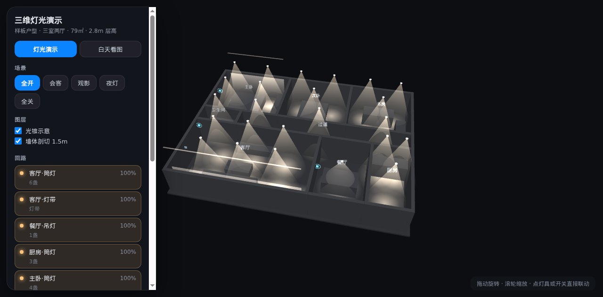
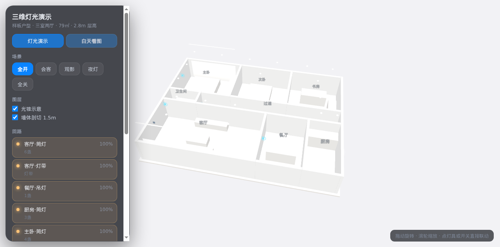

# 光律 Guanglv Workbench · 灯光图纸 → 三维场景 → 智能情景

[](LICENSE)
[](https://www.python.org/downloads/)

> 把一张灯光设计 DXF 图纸，变成可交互的三维灯光场景和成套智能情景。
> *DXF in, scenes out — an open pipeline for lighting designers.*

来自 **光律 GUANGLV**（晷季照明）—— 一套在真实照明项目里跑出来的出图工具，开源给你用。

**当前版本 v1.3.3**：单用户免登录、空库启动；设置页可检查更新并「立即更新」到新版（下载 → 校验 → 备份 → 覆盖 → 重启，数据不动）。

## 版本号怎么看

光律的版本号是 `X.Y.Z` 三段：

- **1.3.4**（第三段变）：只修问题；项目、设置、装法都不用动，点「立即更新」即可。
- **1.4.0**（第二段变）：有新功能；旧项目照常打开，可以放心更。
- **2.0.0**（第一段变）：数据、装法或授权有变化；更新前先读说明、先备份。

发版规则见 [docs/版本号规则.md](docs/版本号规则.md)。




**English?** Jump to [English](#english) — it's a two-command install. Python 3.11+ only: no Node, no database server, no cloud account.

---

## 为什么做这个

灯光行业从图纸到交付，中间全是人力活：翻 CAD 数灯位、对编号、手填情景表——不产设计价值，却最费时间。

这套工具把「图纸 → 空间/灯位 → 三维演示 → 情景表」这条工艺线自动化。能直接用的灯光出图开源件几乎没有（要么是 2D 平面，要么绑死在某个平台里），所以我们把自己的引擎放了出来——数据是标准 JSON，谁都能接，拿走就能用。

## 一条流水线，七个步骤

```
新建 / 导入图纸 ─▶ ① 图纸解析 ─▶ ② 空间确认 ─▶ ③ 布灯 ─▶ ④ 开关与设备
                                                              │
                ⑦ 导出（HTML / JSON / 报价表 / 图纸）◀─ ⑥ 自检 ◀─ ⑤ 智能情景
```

### ① 图纸解析

把 CAD 画的灯源图解析成结构化 JSON：`walls / doors / windows / rooms / lamps / strips / furniture / circuits / unassigned`。

- **墙**：优先读墙图层（带实测厚度）；没有墙图层就按「平行双线」反推——墙整层画在 0 层的图也能用
- **空间**：直接读图纸上写的房间名（带格式码的 MTEXT 也能还原）；没写名字的进「待确认」，不硬猜
- **灯位**：与图纸上的灯具编号（D24 / M50 这类）配对；灯带按多段线还原
- **家具**：块实例 + 闭合轮廓识别；被大轮廓包住的小件不重复计
- **体检**：解析完逐项给人话结论——墙够不够、空间几个、灯位几盏、层高是不是还是默认值

### ② 空间确认

识别结果先以草稿出现，确认后才进入设计数据。空间可以加点、删点、拆并、改名——编号与面积随确认动作重算。

### ③ 布灯

- 灯位可拖、可增删，带编号（空间码 + 位置码 + 职能码 + 序号，如 `kcA001`）
- 随源码附带 **230 款**常见灯具与面板，只含市场零售价（不含任何渠道价、出厂价）
- 产品库可自行维护：改 `backend/local_data/products.json` 即可，字段与导出表一致

### ④ 开关与设备

回路、面板键位、传感器按空间生成；面板刻字可逐键排布。

### ⑤ 智能情景

不逐灯手填。灯具按「空间 × 职能 × 位置」编号，情景用选择器规则推导：

- 内置场景包：**12 个空间 + 全屋级，50 个情景**，每个情景带优先级、渐变时长、触发 / 退出条件
- 一键按「户型 + 本项目空间」筛出可用情景，自动落到每盏灯（开关 / 亮度 / 色温）
- 未命中的灯保持现状、不被误控；彩光只进该进的空间
- 场景表是一份数据文件（`backend/local_data/scene_package.json`），换成你自己的场景体系即可

### ⑥ 自检

导出前拦截检查：回路、编号、层高、空间完整性，有问题先列出来，不让人带着错出图。

### ⑦ 导出

- **业主版交互 HTML**：单个文件、离线可用，点情景就能看灯效
- **项目 JSON**：结构化设计数据，可导入回工作台（`POST /api/projects/import`）
- **Excel / Word / PDF / PNG / DXF / ZIP**：回路表、灯具清单、逐层图纸、整包
- **三维演示页**：光锥 / 光斑 / 回路 / 进屋视角

## 安装：选你的系统

**唯一前提是 Python 3.11+。不需要 Node，不需要数据库，不需要账号和密钥。**

前端已经打包好放在仓库里（`frontend/dist/`），所以拿到就能跑。

| 系统 | 怎么做 | 说明 |
|---|---|---|
| **Windows** | 双击 `start.bat` | 自动挑 3.12 / 3.13 / 3.11；没装会给出下载地址 |
| **macOS / Linux** | `./start.sh` | 自动挑 3.11+ 的解释器；也可直接 `python3.12 start.py` |
| **任何系统（Docker）** | `docker compose up -d` | 连 Python 版本都不用管，适合给非技术同事或放服务器 |

Windows 的 `start.bat` 依赖官方 Python 自带的 `py` 启动器（python.org 安装包默认带）。如果你装的是 Microsoft Store 版 Python，命令行跑 `python start.py` 一样可以。

### 三条命令（macOS / Linux）

```bash
git clone https://github.com/twbzpngd58-beep/guanglv-workbench.git
cd guanglv-workbench
./start.sh
```

`start.sh` 只是个薄壳，真正干活的是 `start.py`：建虚拟环境 → 装依赖 → 拷 `.env` → 起服务。

**首次启动要下依赖（约 1–3 分钟），之后每次都是一秒起。**

打开 `http://127.0.0.1:8000` 就能用。**没有账号、没有密码、没有登录页**——这是单用户本机工作台，谁在这台机器上打开就是谁的工作空间。首次启动是**空库**，不带任何示例项目。

### Docker

```bash
docker compose up -d
docker logs guanglv-workbench      # 看启动是否正常
```

数据落在 `guanglv-data` 卷里，删卷即重置。换端口改 `docker-compose.yml` 里 `8000:8000` 的左边。

## 三分钟跑通一遍

1. 新建项目
2. 上传 `samples/sample-plan.dxf`（仓库自带示例图纸）
3. 系统自动解析出空间与墙段 → 确认空间 → 布灯
4. 切到三维看效果
5. 导出 JSON / Excel / 业主版 HTML

## 改了代码之后怎么办

这是唯一需要记住的操作规矩——很多人改完没生效，都是漏了这一步。

| 你改了什么 | 要做什么 | 耗时 | 要 Node 吗 |
|---|---|---|---|
| 产品库 / 场景包（JSON） | 产品库在界面点「同步」；场景包重启服务 | 10 秒 | 不要 |
| 后端 `backend/*.py` | Ctrl+C 停掉，再跑一次 `start.py`（**后端不热重载**） | 10 秒 | 不要 |
| 前端 `frontend/src/*.tsx` `.css` | `python3 start.py --rebuild` | 有依赖约 6 秒，首次约 3 分钟 | **要 Node 22+** |
| 只想边改边看 | 一个终端 `python3 start.py`，另一个 `cd frontend && npm install && npm run dev`，改完刷 5173 端口 | — | 要 |

`--rebuild` 会自动判断：`frontend/node_modules` 已存在就跳过安装，直接构建。

## 常用参数

```bash
python3 start.py --port 8080        # 换端口（也可改 .env 里的 PORT）
python3 start.py --host 0.0.0.0     # 允许局域网访问（默认只监听本机）
python3 start.py --rebuild          # 改了前端源码后重建
```

## 功能编号与隐藏

工作台里每个功能都有一个固定编号（模块码 + 序号，如 `L-07`），方便沟通某个功能的迭代与修复：

- **右下角「功能清单」**（或快捷键 `Shift + F`）：按编号 / 名称 / 说明搜索，一键定位、隐藏或恢复功能
- **点任一功能**：查看它具体做什么、被改过几次、每次改动对应哪个本机快照，并可按某次改动回退到之前的整版快照
- **「编号」开关**：在界面每个功能旁显示编号徽标，直接点徽标也能查这个功能（徽标上的编号就是沟通用的编号）
- 隐藏后底部会弹出提示（可直接点「恢复」），左下角常驻「已隐藏 N 个功能 / 全部恢复」；隐藏用内联样式落到元素上，切页或重新渲染后仍然生效
- 隐藏只保存在本机当前浏览器，随时可「全部恢复」；右下角入口按钮可收起来，`Shift + F` 仍可打开

功能改动记录在 `data/feature-history.json`（回退程序/前端也不会丢），每次改动用
`python3 scripts/feature_change.py --ids L-01 --title "改了什么" --before <改前快照> --after <改后快照>` 登记一条；
不登记也能用，只是详情里不会出现这次改动、也不能按它回退。

完整清单见 [`docs/功能编号清单.md`](docs/功能编号清单.md)。新增功能时在 `frontend/src/features.ts` 登记编号，并在元素上写 `data-fid="L-07"`（按钮组件用 `fid="L-07"`）。

## 检查更新 / 一键更新

工作台「设置 → 版本与更新」点「检查更新」，后端去 GitHub 问一次版本，三种口径依次回退：

1. 仓库的 latest release
2. 仓库里版本号最大的 tag
3. `main` 分支的 `VERSION` 文件

比较的是版本号本身，不是发布时间。没网、被墙、GitHub 限流都只是显示「检查失败」，不影响本机使用。

```env
# .env 里改成你自己的仓库（fork 之后）
UPDATE_REPO=你的账号/guanglv-workbench
```

**一键更新（1.3.2 起）**：检查到新版后点「立即更新到 vX」，工作台自己完成

```
下载 guanglv-workbench-X.tar.gz → SHA256 校验 → 备份当前版本
→ 停服务 → 覆盖 backend/ frontend/ scripts/ 等程序文件 → 重启 → 自检版本号
```

`data/`（项目、附件、SQLite）和 `.env` 全程不动。设置页有实时进度；万一新版有问题，
双击桌面「光律-回退版本.command」（或版本库里 `version_rollback.sh --to <id>`）就能退回。
更新过程中页面会短暂断线，属于正常现象。

**已经装了 1.3.1 或更早版本**：那些版本只会打开下载页，请到
[Releases](https://github.com/twbzpngd58-beep/guanglv-workbench/releases) 下载
`光律-更新.command`，双击运行（它会自动找安装目录、下载新包、校验、备份、替换、重启），
升级到 1.3.2 之后就都有「立即更新」了。

手动更新（仓库里 `frontend/dist/` 已构建好，覆盖代码不用装 Node）：

```bash
cd guanglv-workbench
git pull            # 或者下载新版本压缩包覆盖
python3 start.py    # 后端重启即生效；data/ 不动，项目还在
```

只想检查不安装（脚本和设置页同一口径）：

```bash
python3 scripts/apply_update.py --check
```

## 发版（维护者）

规则见 [docs/版本号规则.md](docs/版本号规则.md)：三段 `X.Y.Z`，新功能进 minor，修复进 patch，不兼容才进 major；tag 一次性、annotated、不可移动。发版前必须过版本守卫：

```bash
python3 scripts/version_guard.py --bump patch      # 或 minor / major；同步 VERSION、README、package.json
# 手工补 backend/app_versions.py 的 RELEASE_NOTES（从 1.3.4 起每条带 category）和 GitHub Release 说明
cd frontend && npm run build && cd ..
python3 scripts/version_guard.py --baseline        # 前端构建后刷新 build-baseline.json
python3 scripts/version_guard.py --check --strict  # VERSION/README/package.json/baseline/RELEASE_NOTES 一致
python3 scripts/version_guard.py --check-bump --base v1.3.3   # 非 git 目录；发版仓库里可省 --base
python3 scripts/build_release.py                   # 生成 dist-release/（内部再跑一次版本校验）
git status                                          # 发版仓工作区必须是干净的，别把旧文件带回来
git add -A && git commit -m "v$(cat VERSION)：…"
git tag -a "v$(cat VERSION)" -m "光律 v$(cat VERSION)"
python3 scripts/version_guard.py --check-tag "v$(cat VERSION)"
git push origin main "v$(cat VERSION)"
# 在 GitHub Releases 用该 tag 建正式 Release，上传 dist-release/ 的 4 个资产（不要勾 prerelease）
```

`build_release.py` 只打包程序资产（不含 `data/`、`.env`、`.venv/`、`node_modules/`），
前端用的是已经构建好的 `frontend/dist/`，所以发行包解压即用、不需要 Node。

Release 资产固定 4 件：`guanglv-workbench-<版本>.tar.gz`、`SHA256SUMS.txt`、`apply_update.py`、
`guanglv-update.command`。包字节一变就必须发新 patch；同一个 tag 只允许字节相同的重传。

## 数据与配置

- 数据全在 `data/`（SQLite + 上传文件），删掉就等于全部重置
- 配置在 `.env`（首次启动自动从 `.env.example` 复制）：`HOST` / `PORT` / `DATA_DIR` / `MAX_UPLOAD_MB` / `UPDATE_REPO`
- 想换图纸识别模型，改 `.env` 里的 `PLAN_VISION_*`；不填也能出图，用的是本地几何分析

## 接入你自己的 AI（可选）

核心出图（解析 / 三维 / 情景）**不调用任何 AI**，断网也能用。要让「图纸语义识图」更强，可以在 `.env` 里填自己的服务：

```env
PLAN_VISION_PROVIDER=http        # 或沿用 local
PLAN_VISION_URL=https://你的服务/v1/vision
PLAN_VISION_TOKEN=你的令牌
AI_API_KEY=你的密钥
```

## 目录

```
backend/
  app.py              主应用（FastAPI）
  dxf_lighting.py     图纸解析器（纯 Python，可独立跑）
  lighting3d.py       三维灯光模块 + 引擎页
  exports.py          导出（HTML / JSON / Excel / Word / PDF / ZIP）
  local_data/         随源码分发的产品库（230 款）与场景包（50 套）
frontend/             React + TypeScript 前端（已带构建产物 dist/，无需 Node）
samples/              示例图纸，可直接上传试跑
scripts/              维护脚本（备份、发版、字体重建、容器启动）
start.py              跨平台启动器（建环境、装依赖、起服务）
Dockerfile            容器镜像
requirements.txt      Python 依赖
```

## 实测

一份真实住宅灯光图 ≈ 20–25 秒解析完：8–13 个空间、45+ 灯位、130–250 段墙、20+ 件家具（视图纸而定）。

## 边界（先说清楚）

- 解析是「高质量草稿」，不是全自动：编号配对、房间名、面积口径以人工确认为准，结果里带体检和待确认清单
- 三维是**观感演示**：不做照度计算，不能当施工或报价依据
- 家具类型按形状尺寸推断，会出错——可以手动改
- 施工、电气校核、正式报价仍须专业人员
- 服务默认只监听 `127.0.0.1`。它没有登录口令，**不要直接暴露到公网**；确实要在局域网共享，用 `--host 0.0.0.0` 并自己加反向代理与访问控制

## 许可

MIT License（内置 three.js、字体等遵循其自身许可）。绘图字体 `GuanglvPlanSans` 由 Droid Sans Fallback 与 DejaVu Sans 合成，两份许可证随 `backend/fonts/` 一并分发。

## 关于光律 GUANGLV

由光律 GUANGLV（晷季照明）开源——我们做照明设计、智能情景与灯具产品；这套图纸解析 / 三维渲染 / 情景规则，全部来自真实项目的打磨。

开源的是这条工艺线的上游；如果你要把它用进真实项目——设计、智能、产品、落地交付——欢迎找我们。

## 联系我们

<table>
<tr>
<td align="center" width="33%">

**技术咨询**

出图、三维、情景规则怎么用


</td>
<td align="center" width="33%">

**商务合作**

设计、智能、产品与落地交付


</td>
<td align="center" width="33%">

**KNX培训课程咨询**

KNX 系统课程与项目陪跑


</td>
</tr>
</table>

同一组二维码也内嵌在工作台里：**使用指南**弹窗底部「需要帮助？」和**工作台设置 → 关于与联系**。
